# Architecture: Automated Documentation Sync Agent

## 1. Purpose
The Automated Documentation Sync Agent is designed to monitor source-of-truth artifacts, detect relevant changes, determine the impacted documentation, generate accurate documentation updates, and route them through a human review workflow before merge. The architecture supports incremental processing, traceability, and controlled automation for documentation maintenance.

This architecture is grounded in the requirements defined in [requirements.md](requirements.md) and is intended to balance automation with governance.

## 2. Architectural Goals
- Reduce documentation drift by syncing changes from source repositories into documentation repos.
- Keep the system modular so new source integrations and output formats can be added without redesign.
- Preserve human oversight for risky or ambiguous documentation updates.
- Ensure auditability and rollback support for generated change sets.
- Support both scheduled workflows and event-driven triggers.

## 3. High-Level System View
The system consists of five primary layers:

1. Source Integration Layer
   - Connects to code repositories, API specifications, config files, changelogs, and release metadata.

2. Change Detection and Analysis Layer
   - Watches for new commits, PRs, tags, and file updates and classifies the type of change.

3. Mapping and Generation Layer
   - Maps source changes to documentation targets and generates content updates.

4. Validation and Review Layer
   - Runs linting, link checks, schema validation, and approval workflows.

5. Governance and Persistence Layer
   - Stores run history, diffs, metadata, audit logs, and rollback state.

## 4. Component Breakdown

### 4.1 Source Connectors
Responsible for reading data from external systems.

Responsibilities:
- Authenticate to Git repositories and release providers.
- Poll or subscribe to repository events.
- Read configured files, schemas, manifests, and metadata.
- Normalize raw artifact data into a standard internal model.

Typical components:
- GitHub/GitLab Connector
- API Spec Reader
- Config/Manifest Scanner
- Release Metadata Collector

### 4.2 Event Scheduler and Trigger Manager
Responsible for initiating sync workflows.

Responsibilities:
- Trigger syncs on push events, PR merges, schedules, or manual requests.
- De-duplicate event-driven runs.
- Queue jobs for processing and handle retries.

Typical components:
- Cron/Scheduler
- Webhook Event Handler
- Job Queue
- Retry Manager

### 4.3 Change Intelligence Engine
Responsible for analyzing raw changes and identifying document-impacting updates.

Responsibilities:
- Diff source files and evaluate relevance.
- Classify changes as API, configuration, dependency, release, environment, or doc-related changes.
- Determine risk level and confidence of the change.
- Flag ambiguous or conflicting cases for manual review.

Typical components:
- Diff Analyzer
- Change Classifier
- Risk Scorer
- Ambiguity Detector

### 4.4 Documentation Mapper
Responsible for linking source changes to documentation targets and templates.

Responsibilities:
- Match sources to target documents by repository path, version, schema, or template rules.
- Support version-specific mappings and release branches.
- Preserve manual content sections that are intentionally editable.
- Maintain mapping metadata for traceability.

Typical components:
- Rule Engine
- Template Resolver
- Versioning Mapper
- Documentation Index

### 4.5 Content Generation Service
Responsible for producing documentation updates.

Responsibilities:
- Generate summaries, Markdown sections, API references, release notes, or config docs.
- Update existing pages without overwriting protected regions.
- Insert structured content in the correct file locations.
- Capture source provenance for each generated change.

Typical components:
- Markdown Renderer
- Schema-to-Docs Transformer
- Release Note Generator
- Patch Builder

### 4.6 Validation Engine
Responsible for validating generated output before approval.

Responsibilities:
- Run markdown linting, link checking, and schema validation.
- Detect broken references and formatting issues.
- Evaluate confidence thresholds for auto-approval versus manual review.

Typical components:
- Lint Checks
- Link Validator
- Schema Validator
- QA Gate

### 4.7 Review and Approval Workflow
Responsible for controlled human approval.

Responsibilities:
- Create a pull request or commit patch for review.
- Provide summaries of changed sections and affected sources.
- Support approve/reject/modify states.
- Block or escalate risky updates.

Typical components:
- Pull Request Creator
- Review Summary Generator
- Approval Policy Engine
- Human Review Inbox

### 4.8 Audit and Storage Layer
Responsible for persistence and traceability.

Responsibilities:
- Store run metadata, diffs, generated patches, approvals, and revert actions.
- Provide audit history and rollback capability.
- Protect secret data and restrict write access.

Typical components:
- Metadata Store
- Document Diff Store
- Run History Database
- Secret Vault

## 5. Runtime Data Flow
The core end-to-end flow is:

1. A source repository or metadata provider emits a change event.
2. The trigger manager schedules or queues a sync job.
3. Connectors fetch relevant files and metadata.
4. The change intelligence engine analyzes relevance and impact.
5. The mapper resolves the target documentation set and version context.
6. The content generation service updates documentation or creates a patch.
7. Validation checks run on the generated content.
8. The review workflow opens a reviewable change for approval.
9. Approved updates are merged into the docs repository.
10. Audit records and diffs are saved for future traceability and rollback.

## 6. Data Flow Diagram

```mermaid
flowchart LR
    A[Source Repos / APIs / Configs / Releases] --> B[Source Connectors]
    B --> C[Trigger Manager]
    C --> D[Change Intelligence Engine]
    D --> E[Documentation Mapper]
    E --> F[Content Generation Service]
    F --> G[Validation Engine]
    G --> H[Review & Approval Workflow]
    H --> I[Documentation Repository]
    I --> J[Audit & Storage Layer]
    J --> K[Rollback / Traceability History]

    D -->|Ambiguity / Risk| H
    G -->|Reject / Needs Revision| F
    H -->|Approved| I
    I -->|Diffs & metadata| J
```

## 7. Technology Stack Choices
The architecture is designed to be pragmatic, modular, and compatible with Git-based documentation workflows.

### 7.1 Core Platform
- Python: Primary language for orchestration, analysis, rule processing, and content generation.
- Git: Repository-based integration for source changes and documentation updates.
- Markdown: Native documentation format for generated and reviewed content.

### 7.2 Integration and Processing
- GitHub/GitLab API clients for repository and PR integration.
- Webhook handlers for event-driven triggers.
- Async job queue such as Celery, RQ, or Azure Functions depending on deployment target.
- Scheduled tasks with cron, GitHub Actions, or orchestration services.

### 7.3 AI and Analysis Components
- LLM or rule-based summarization engine to generate document content from source changes.
- Structured parsing libraries for YAML, JSON, OpenAPI, and configuration files.
- Natural-language generation and classification components to identify docs impact.

### 7.4 Validation and Quality Gates
- Markdown linting tools such as markdownlint.
- Link validation tools.
- JSON/YAML schema validation.
- Custom validation rules for repository-specific docs standards.

### 7.5 Persistence and Security
- Relational or document database to store runs, diffs, and approvals.
- Secret manager such as Azure Key Vault, AWS Secrets Manager, or GitHub Actions secrets.
- Role-based access controls and repository-level permissions.

### 7.6 Deployment Model
- Containerized services using Docker for portability.
- Optionally deployed on a serverless or container orchestration platform.
- CI/CD via GitHub Actions, Azure DevOps, or equivalent pipeline tooling.

## 8. Key Design Decisions

### 8.1 Human-in-the-Loop Review
The system does not auto-merge every documentation update. Risky mappings, ambiguous changes, or broad schema changes are routed to human review to protect accuracy and reduce false documentation updates.

### 8.2 Source-to-Docs Traceability
Every generated document patch is linked back to source commit metadata so that both authors and reviewers can confirm what triggered the update.

### 8.3 Version-Aware Mapping
The architecture supports versioned docs and release-specific mappings, which is essential for maintaining current and historical documentation states accurately.

### 8.4 Modular Connectors
Each source type is isolated behind a connector interface so new integrations do not require major architectural changes.

## 9. Quality Attributes

### Reliability
- Retry logic for transient failures.
- Event deduplication and failure logging.
- Graceful handling of repository or API outages.

### Scalability
- Incremental diffing and targeted scanning reduce processing overhead.
- Additional repositories can be added with configuration instead of code changes.

### Maintainability
- Rule-based mappings and config-driven behaviors are easier to update than embedded logic.
- Components are separated by responsibility.

### Security
- Secrets stay in managed secret stores.
- Repository permissions are enforced at the workflow layer.
- Protected doc paths and sensitive files are excluded from automatic write operations unless approved.

## 10. Risks and Mitigations

### Risk: Incorrect documentation changes
Mitigation: confidence scoring, review gates, and ambiguity detection.

### Risk: Overwriting manual edits
Mitigation: protected sections, patch-based updates, and explicit merge policies.

### Risk: Repository noise from irrelevant changes
Mitigation: file filters, change classifiers, and path-based configuration.

### Risk: Broken docs or links
Mitigation: validation checks before review submission.

## 11. Recommended Initial Implementation Scope
For the first release, the architecture should prioritize:
- One or two source connectors (e.g., Git repository + API spec).
- Single documentation repo with versioned docs structure.
- Rule-based mapping with explicit human approval for high-risk updates.
- Markdown generation and validation pipeline.
- Audit history and rollback support.

This phased implementation aligns with the stated requirements while keeping the system manageable and testable.

## 12. Summary
The Automated Documentation Sync Agent is best designed as a modular, event-driven documentation automation platform that blends repository monitoring, intelligent change analysis, generated content updates, and human review controls. The architecture keeps automation useful while ensuring that documentation quality, traceability, and governance remain intact.
